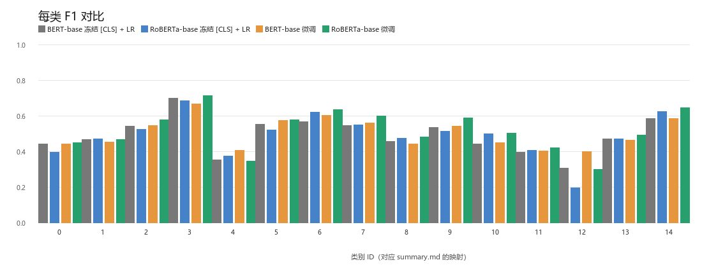
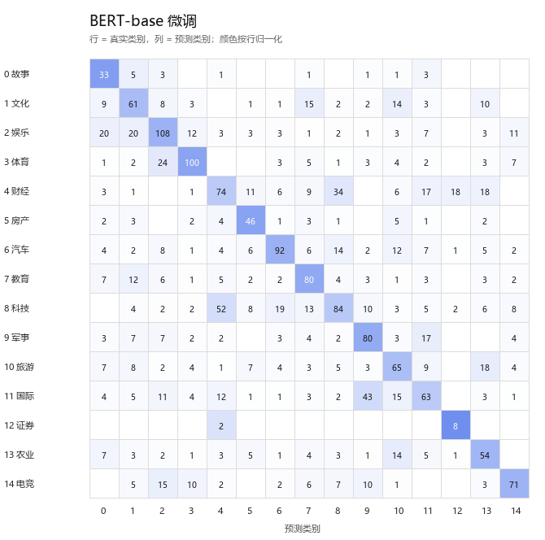
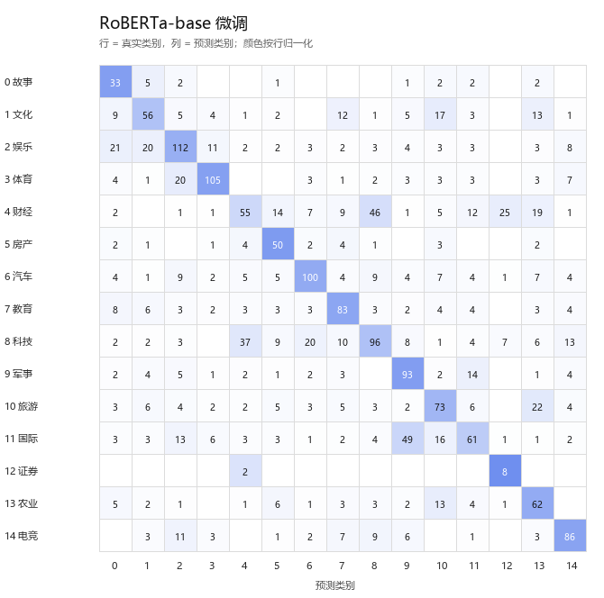
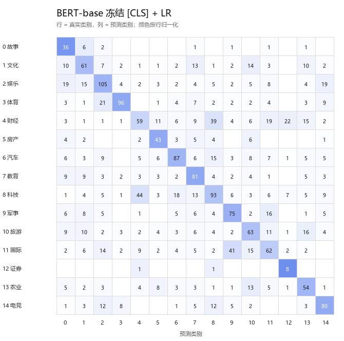
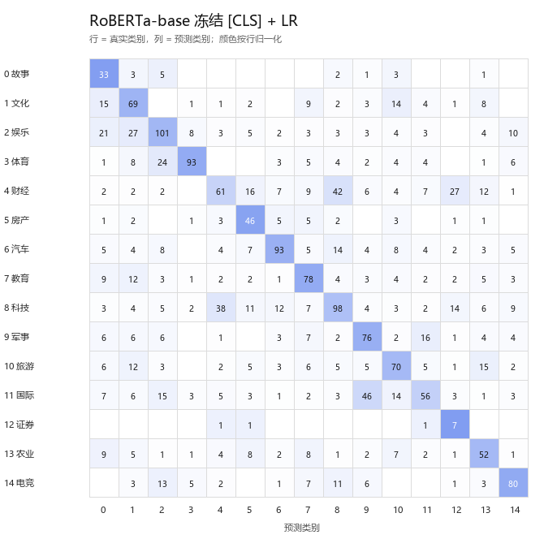
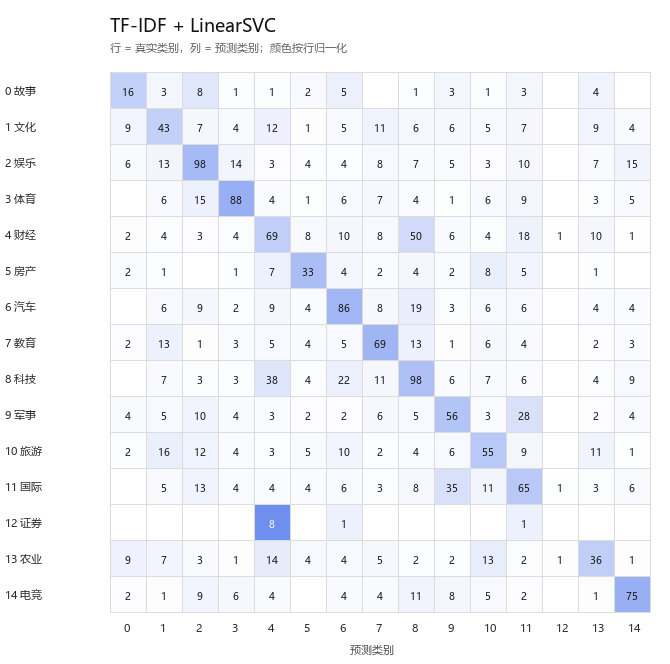
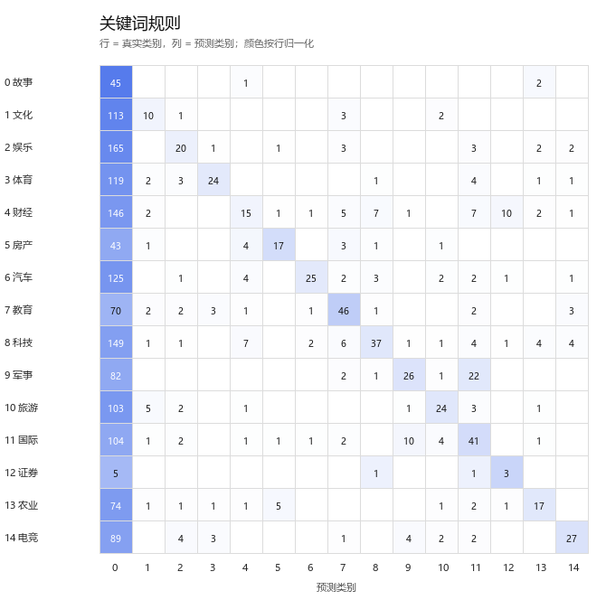

# 换预训练模型对比实验：BERT-base vs RoBERTa-base

同一 TNEWS 数据切分、同一分类头、同一超参，只替换预训练骨干。

## 1. 实验设置

| 项目 | 值 | 说明 |
| --- | --- | --- |
| 原始训练集 | 53360 | 清洗前 train.json |
| 训练集内部重复 | 3634 | 按整句完全去重 |
| 原始验证集 | 10000 | 清洗前 val.json |
| 验证集与训练集重复 | 1099 | 评测前删除 |
| 去重后验证集 | 8901 | 作为测试集池 |
| 训练 / 开发 / 测试 | 7000 / 1000 / 2000 | 固定 seed=42 分层抽样 |
| max_len | 40 | TNEWS 句子 p99≈39 |
| 骨干 | BERT-base-chinese / RoBERTa-base | 均为 12 层 / 768 隐藏，约 102M 参数 |

## 2. 主结果（按 Macro-F1 排序）

| 方法 | 准确率(含失败) | Macro-F1 | 覆盖类别 | 训练成本 |
| --- | --- | --- | --- | --- |
| **RoBERTa 微调** | 0.536 | 0.522 | 15/15 | 28.9 分钟 / 411 MB |
| BERT 微调 | 0.509 | 0.505 | 15/15 | 33.0 分钟 / 393 MB |
| BERT 冻结 + LR | 0.501 | 0.493 | 15/15 | 4.5 分钟 / 393 MB |
| RoBERTa 冻结 + LR | 0.506 | 0.490 | 15/15 | 4.3 分钟 / 411 MB |
| TF-IDF + SVM | 0.444 | 0.409 | 15/15 | 2 秒 |
| TF-IDF + NB | 0.422 | 0.385 | 14/15 | 1 秒 |
| 规则 / 关键词 | 0.189 | 0.251 | 15/15 | — |

> **准确率(含失败)**：本实验所有方法都会输出一个标签，没有解析失败/弃权，因此该列等于普通 Accuracy。
>
> **覆盖类别**：测试集上实际预测到的不同类别数 / 15；用来发现模型塌缩到少数类。
>
> **训练成本**：CPU（16 线程）实测；`/ 393 MB` 表示权重体积。

### 补充：校准与推理成本

| 方法 | Weighted-F1 | ECE | 推理 ms/条 | 权重 MB |
| --- | --- | --- | --- | --- |
| RoBERTa-base 微调 | 0.5341 | 0.0357 | 33.92 | 411 |
| BERT-base 微调 | 0.5096 | 0.1324 | 33.77 | 393 |
| BERT-base 冻结 [CLS] + LR | 0.5023 | 0.0825 | 36.30 | 393 |
| RoBERTa-base 冻结 [CLS] + LR | 0.5113 | 0.1970 | 36.39 | 411 |
| TF-IDF + LinearSVC | 0.4431 | - | 0.07 | - |
| TF-IDF + MultinomialNB | 0.4194 | 0.0560 | 0.06 | - |
| 关键词规则 | 0.2526 | - | 0.03 | - |

> ECE 为 `-` 表示该方法没有输出概率（规则/LinearSVC），不参与校准比较。

## 3. 核心结论

- 最佳方法：**RoBERTa-base 微调**，Macro-F1 **0.5222**，Accuracy 0.5365。
- 微调对比：RoBERTa 比 BERT 高 **1.72** 个百分点；McNemar b=134, c=188, p=0.0031（显著）。
- 微调相对冻结特征：BERT 提升 **1.20** 个百分点，RoBERTa 提升 **3.18** 个百分点。
- 每类对比：RoBERTa 在 **13/15** 类上更高；提升最大的是 **电竞（+5.98 pp）**，下降最大的是 **证券（-9.81 pp）**。
- 覆盖类别：6/7 个方法覆盖全部 15 类；没有出现 zero-shot 式的类别塌缩。
- 冻结特征对比：RoBERTa 比 BERT 低 **0.27** 个百分点；McNemar b=168, c=178, p=0.6286（不显著）。
- 传统基线：TF-IDF + LinearSVC 的 Macro-F1 为 0.4088，比最佳方法低 **11.34** 个百分点。
- 规则基线：关键词规则 Macro-F1 仅 0.2509，说明这个任务不能只靠少量关键词。
- 注意：以上是单 seed、2,000 条测试集的结果；Macro-F1 差距小于约 1 个百分点、或 McNemar p≥0.05 时，建议表述为“趋势”而不是“显著更好”。

## 4. 每类 F1

| 类别 | BERT-base 冻结 [CLS] + LR F1 | RoBERTa-base 冻结 [CLS] + LR F1 | BERT-base 微调 F1 | RoBERTa-base 微调 F1 | Δ RoBERTa-BERT (微调) |
| --- | --- | --- | --- | --- | --- |
| 0 故事 | 0.4444 | 0.3976 | 0.4459 | 0.4521 | +0.61 pp |
| 1 文化 | 0.4692 | 0.4726 | 0.4569 | 0.4686 | +1.17 pp |
| 2 娱乐 | 0.5440 | 0.5274 | 0.5496 | 0.5803 | +3.07 pp |
| 3 体育 | 0.7007 | 0.6889 | 0.6711 | 0.7167 | +4.56 pp |
| 4 财经 | 0.3565 | 0.3754 | 0.4077 | 0.3492 | -5.85 pp |
| 5 房产 | 0.5548 | 0.5227 | 0.5750 | 0.5814 | +0.64 pp |
| 6 汽车 | 0.5686 | 0.6221 | 0.6053 | 0.6390 | +3.37 pp |
| 7 教育 | 0.5492 | 0.5532 | 0.5634 | 0.6014 | +3.81 pp |
| 8 科技 | 0.4593 | 0.4769 | 0.4433 | 0.4824 | +3.91 pp |
| 9 军事 | 0.5357 | 0.5153 | 0.5461 | 0.5924 | +4.63 pp |
| 10 旅游 | 0.4452 | 0.5000 | 0.4530 | 0.5052 | +5.22 pp |
| 11 国际 | 0.3987 | 0.4088 | 0.4065 | 0.4221 | +1.57 pp |
| 12 证券 | 0.3077 | 0.1972 | 0.4000 | 0.3019 | -9.81 pp |
| 13 农业 | 0.4737 | 0.4727 | 0.4655 | 0.4940 | +2.85 pp |
| 14 电竞 | 0.5882 | 0.6250 | 0.5868 | 0.6466 | +5.98 pp |

## 5. 混淆矩阵

### BERT-base 微调

### RoBERTa-base 微调

### BERT-base 冻结 [CLS] + LR

### RoBERTa-base 冻结 [CLS] + LR

### TF-IDF + LinearSVC

### 关键词规则

## 6. Top 混淆对

| 方法 | 真实 → 预测 | 次数 |
| --- | --- | --- |
| BERT-base 微调 | 科技 → 财经 | 52 |
| BERT-base 微调 | 国际 → 军事 | 43 |
| BERT-base 微调 | 财经 → 科技 | 34 |
| BERT-base 微调 | 体育 → 娱乐 | 24 |
| BERT-base 微调 | 娱乐 → 文化 | 20 |
| BERT-base 微调 | 娱乐 → 故事 | 20 |
| BERT-base 微调 | 科技 → 汽车 | 19 |
| BERT-base 微调 | 财经 → 证券 | 18 |
| RoBERTa-base 微调 | 国际 → 军事 | 49 |
| RoBERTa-base 微调 | 财经 → 科技 | 46 |
| RoBERTa-base 微调 | 科技 → 财经 | 37 |
| RoBERTa-base 微调 | 财经 → 证券 | 25 |
| RoBERTa-base 微调 | 旅游 → 农业 | 22 |
| RoBERTa-base 微调 | 娱乐 → 故事 | 21 |
| RoBERTa-base 微调 | 科技 → 汽车 | 20 |
| RoBERTa-base 微调 | 娱乐 → 文化 | 20 |
| BERT-base 冻结 [CLS] + LR | 科技 → 财经 | 44 |
| BERT-base 冻结 [CLS] + LR | 国际 → 军事 | 41 |
| BERT-base 冻结 [CLS] + LR | 财经 → 科技 | 39 |
| BERT-base 冻结 [CLS] + LR | 财经 → 证券 | 22 |
| BERT-base 冻结 [CLS] + LR | 体育 → 娱乐 | 21 |
| BERT-base 冻结 [CLS] + LR | 财经 → 国际 | 19 |
| BERT-base 冻结 [CLS] + LR | 娱乐 → 电竞 | 19 |
| BERT-base 冻结 [CLS] + LR | 娱乐 → 故事 | 19 |
| RoBERTa-base 冻结 [CLS] + LR | 国际 → 军事 | 46 |
| RoBERTa-base 冻结 [CLS] + LR | 财经 → 科技 | 42 |
| RoBERTa-base 冻结 [CLS] + LR | 科技 → 财经 | 38 |
| RoBERTa-base 冻结 [CLS] + LR | 财经 → 证券 | 27 |
| RoBERTa-base 冻结 [CLS] + LR | 娱乐 → 文化 | 27 |
| RoBERTa-base 冻结 [CLS] + LR | 体育 → 娱乐 | 24 |
| RoBERTa-base 冻结 [CLS] + LR | 娱乐 → 故事 | 21 |
| RoBERTa-base 冻结 [CLS] + LR | 财经 → 房产 | 16 |

## 7. 成本与复现

- 训练/推理时间均为 CPU（16 线程）实测；不同机器会有差异。
- 复现：`python run_all.py --methods all --force`；冒烟：`python run_all.py --smoke --methods all --force`。
- 错例：见 [errors.md](errors.md)。
- 课程原 summary 里的 Qwen3 zero-shot / LoRA / 全量微调 / API 行来自 500 条干净验证集的另一套实验，本次没有重跑；为避免不同测试集口径混比，未并入主表。

## 8. 类别 ID 映射

| ID | 类别 |
| --- | --- |
| 0 | 故事 |
| 1 | 文化 |
| 2 | 娱乐 |
| 3 | 体育 |
| 4 | 财经 |
| 5 | 房产 |
| 6 | 汽车 |
| 7 | 教育 |
| 8 | 科技 |
| 9 | 军事 |
| 10 | 旅游 |
| 11 | 国际 |
| 12 | 证券 |
| 13 | 农业 |
| 14 | 电竞 |
