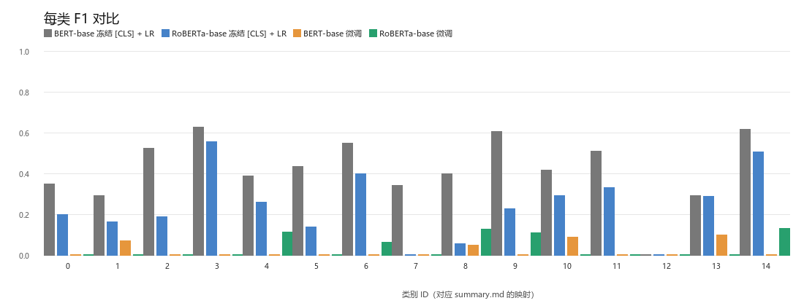
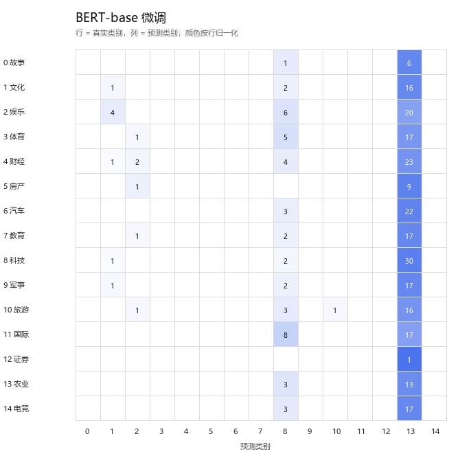
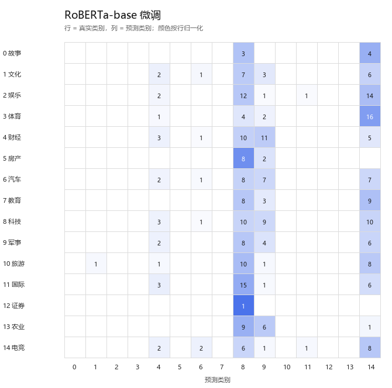
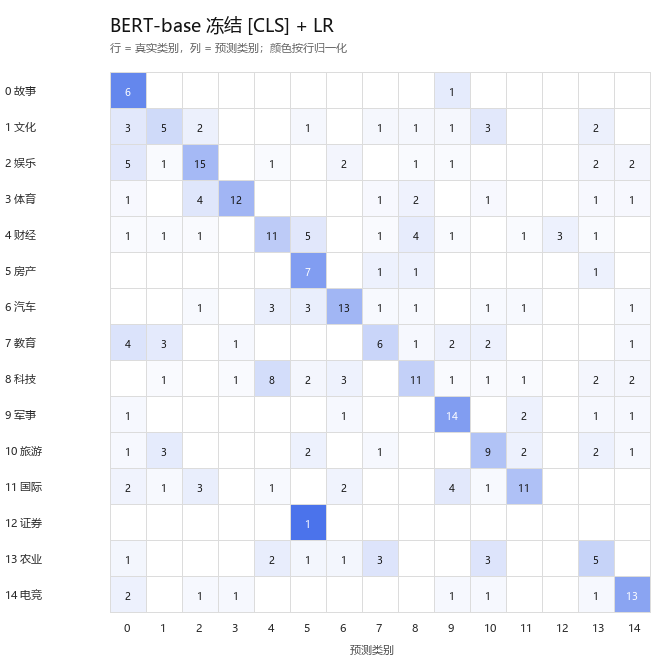
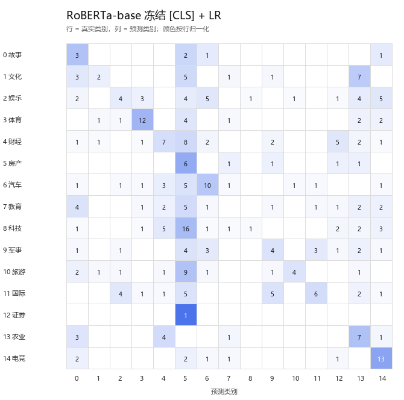
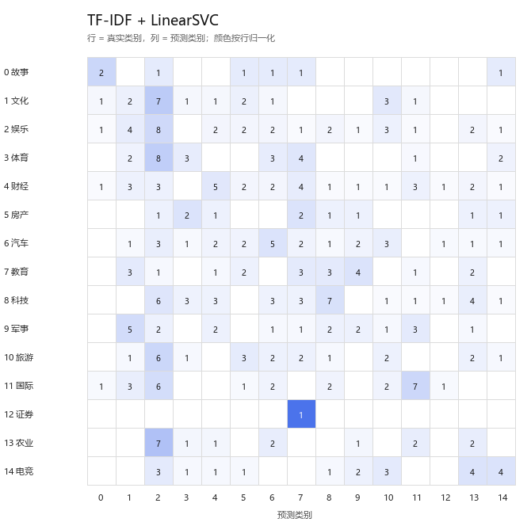
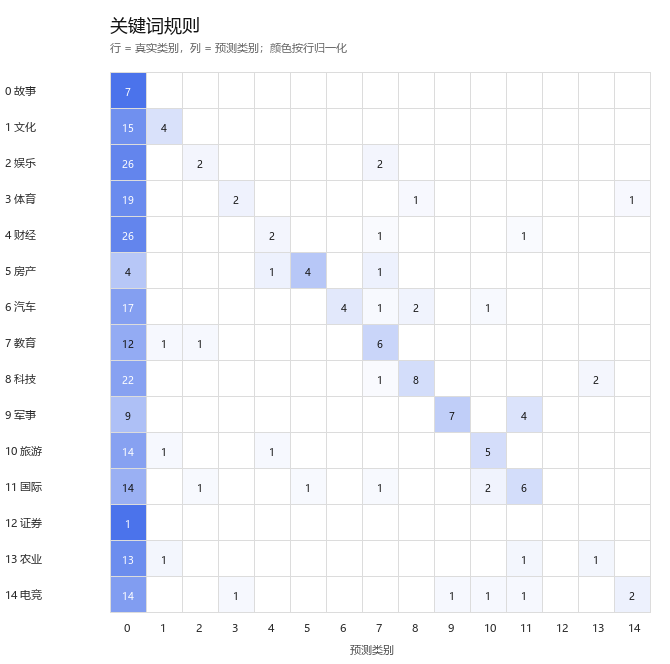

# 换预训练模型对比实验：BERT-base vs RoBERTa-base

同一 TNEWS 数据切分、同一分类头、同一超参，只替换预训练骨干。

## 1. 实验设置

| 项目 | 值 | 说明 |
| --- | --- | --- |
| 原始训练集 | 53360 | 清洗前 train.json |
| 训练集内部重复 | 3634 | 按整句完全去重 |
| 原始验证集 | 10000 | 清洗前 val.json |
| 验证集与训练集重复 | 1099 | 评测前删除 |
| 去重后验证集 | 8901 | 作为测试集池 |
| 训练 / 开发 / 测试 | 7000 / 1000 / 2000 | 固定 seed=42 分层抽样 |
| max_len | 40 | TNEWS 句子 p99≈39 |
| 骨干 | BERT-base-chinese / RoBERTa-base | 均为 12 层 / 768 隐藏，约 102M 参数 |

## 2. 主结果（按 Macro-F1 排序）

| 方法 | Acc | Macro-F1 | Weighted-F1 | ECE | 训练秒 | 推理 ms/条 | 参数 M | 权重 MB |
| --- | --- | --- | --- | --- | --- | --- | --- | --- |
| BERT-base 冻结 [CLS] + LR | 0.4600 | 0.4256 | 0.4642 | 0.3462 | 13.1 | 34.66 | - | 393 |
| 关键词规则 | 0.2000 | 0.2483 | 0.2615 | - | 0.0 | 0.02 | - | - |
| RoBERTa-base 冻结 [CLS] + LR | 0.2633 | 0.2424 | 0.2610 | 0.1614 | 12.0 | 34.54 | - | 411 |
| TF-IDF + LinearSVC | 0.1733 | 0.1616 | 0.1810 | - | 0.0 | 0.04 | - | - |
| TF-IDF + MultinomialNB | 0.1933 | 0.1521 | 0.1780 | 0.0988 | 0.1 | 0.04 | - | - |
| RoBERTa-base 微调 | 0.0867 | 0.0373 | 0.0480 | 0.0117 | 27.7 | 49.63 | 102.2790 | 411 |
| BERT-base 微调 | 0.0567 | 0.0212 | 0.0222 | 0.1072 | 24.1 | 50.91 | 102.2790 | 393 |

> ECE 为 `-` 表示该方法没有输出概率（规则/LinearSVC），不参与校准比较。

## 3. 核心结论

- 最佳方法：**BERT-base 冻结 [CLS] + LR**，Macro-F1 **0.4256**，Accuracy 0.4600。
- 微调对比：RoBERTa 比 BERT 高 **1.61** 个百分点；McNemar b=17, c=26, p=0.2221（不显著）。
- 冻结特征对比：RoBERTa 比 BERT 低 **18.32** 个百分点；McNemar b=81, c=22, p=0.0000（显著）。
- 传统基线：TF-IDF + LinearSVC 的 Macro-F1 为 0.1616，比最佳方法低 **26.39** 个百分点。
- 规则基线：关键词规则 Macro-F1 仅 0.2483，说明这个任务不能只靠少量关键词。
- 注意：以上是单 seed、2,000 条测试集的结果；Macro-F1 差距小于约 1 个百分点、或 McNemar p≥0.05 时，建议表述为“趋势”而不是“显著更好”。

## 4. 每类 F1

| 类别 | BERT-base 冻结 [CLS] + LR F1 | RoBERTa-base 冻结 [CLS] + LR F1 | BERT-base 微调 F1 | RoBERTa-base 微调 F1 | Δ RoBERTa-BERT (微调) |
| --- | --- | --- | --- | --- | --- |
| 0 故事 | 0.3529 | 0.2000 | 0.0000 | 0.0000 | +0.00 pp |
| 1 文化 | 0.2941 | 0.1667 | 0.0741 | 0.0000 | -7.41 pp |
| 2 娱乐 | 0.5263 | 0.1905 | 0.0000 | 0.0000 | +0.00 pp |
| 3 体育 | 0.6316 | 0.5581 | 0.0000 | 0.0000 | +0.00 pp |
| 4 财经 | 0.3929 | 0.2642 | 0.0000 | 0.1176 | +11.76 pp |
| 5 房产 | 0.4375 | 0.1395 | 0.0000 | 0.0000 | +0.00 pp |
| 6 汽车 | 0.5532 | 0.4000 | 0.0000 | 0.0645 | +6.45 pp |
| 7 教育 | 0.3429 | 0.0000 | 0.0000 | 0.0000 | +0.00 pp |
| 8 科技 | 0.4000 | 0.0571 | 0.0519 | 0.1316 | +7.96 pp |
| 9 军事 | 0.6087 | 0.2286 | 0.0000 | 0.1127 | +11.27 pp |
| 10 旅游 | 0.4186 | 0.2963 | 0.0909 | 0.0000 | -9.09 pp |
| 11 国际 | 0.5116 | 0.3333 | 0.0000 | 0.0000 | +0.00 pp |
| 12 证券 | 0.0000 | 0.0000 | 0.0000 | 0.0000 | +0.00 pp |
| 13 农业 | 0.2941 | 0.2917 | 0.1012 | 0.0000 | -10.12 pp |
| 14 电竞 | 0.6190 | 0.5098 | 0.0000 | 0.1333 | +13.33 pp |

## 5. 混淆矩阵

### BERT-base 微调

### RoBERTa-base 微调

### BERT-base 冻结 [CLS] + LR

### RoBERTa-base 冻结 [CLS] + LR

### TF-IDF + LinearSVC

### 关键词规则

## 6. Top 混淆对

| 方法 | 真实 → 预测 | 次数 |
| --- | --- | --- |
| BERT-base 微调 | 科技 → 农业 | 30 |
| BERT-base 微调 | 财经 → 农业 | 23 |
| BERT-base 微调 | 汽车 → 农业 | 22 |
| BERT-base 微调 | 娱乐 → 农业 | 20 |
| BERT-base 微调 | 电竞 → 农业 | 17 |
| BERT-base 微调 | 教育 → 农业 | 17 |
| BERT-base 微调 | 国际 → 农业 | 17 |
| BERT-base 微调 | 军事 → 农业 | 17 |
| RoBERTa-base 微调 | 体育 → 电竞 | 16 |
| RoBERTa-base 微调 | 国际 → 科技 | 15 |
| RoBERTa-base 微调 | 娱乐 → 电竞 | 14 |
| RoBERTa-base 微调 | 娱乐 → 科技 | 12 |
| RoBERTa-base 微调 | 财经 → 军事 | 11 |
| RoBERTa-base 微调 | 财经 → 科技 | 10 |
| RoBERTa-base 微调 | 科技 → 电竞 | 10 |
| RoBERTa-base 微调 | 旅游 → 科技 | 10 |
| BERT-base 冻结 [CLS] + LR | 科技 → 财经 | 8 |
| BERT-base 冻结 [CLS] + LR | 财经 → 房产 | 5 |
| BERT-base 冻结 [CLS] + LR | 娱乐 → 故事 | 5 |
| BERT-base 冻结 [CLS] + LR | 财经 → 科技 | 4 |
| BERT-base 冻结 [CLS] + LR | 教育 → 故事 | 4 |
| BERT-base 冻结 [CLS] + LR | 国际 → 军事 | 4 |
| BERT-base 冻结 [CLS] + LR | 体育 → 娱乐 | 4 |
| BERT-base 冻结 [CLS] + LR | 财经 → 证券 | 3 |
| RoBERTa-base 冻结 [CLS] + LR | 科技 → 房产 | 16 |
| RoBERTa-base 冻结 [CLS] + LR | 旅游 → 房产 | 9 |
| RoBERTa-base 冻结 [CLS] + LR | 财经 → 房产 | 8 |
| RoBERTa-base 冻结 [CLS] + LR | 文化 → 农业 | 7 |
| RoBERTa-base 冻结 [CLS] + LR | 财经 → 证券 | 5 |
| RoBERTa-base 冻结 [CLS] + LR | 科技 → 财经 | 5 |
| RoBERTa-base 冻结 [CLS] + LR | 汽车 → 房产 | 5 |
| RoBERTa-base 冻结 [CLS] + LR | 文化 → 房产 | 5 |

## 7. 成本与复现

- 训练/推理时间均为 CPU（16 线程）实测；不同机器会有差异。
- 复现：`python run_all.py --methods all --force`；冒烟：`python run_all.py --smoke --methods all --force`。
- 错例：见 [errors.md](errors.md)。

## 8. 类别 ID 映射

| ID | 类别 |
| --- | --- |
| 0 | 故事 |
| 1 | 文化 |
| 2 | 娱乐 |
| 3 | 体育 |
| 4 | 财经 |
| 5 | 房产 |
| 6 | 汽车 |
| 7 | 教育 |
| 8 | 科技 |
| 9 | 军事 |
| 10 | 旅游 |
| 11 | 国际 |
| 12 | 证券 |
| 13 | 农业 |
| 14 | 电竞 |
