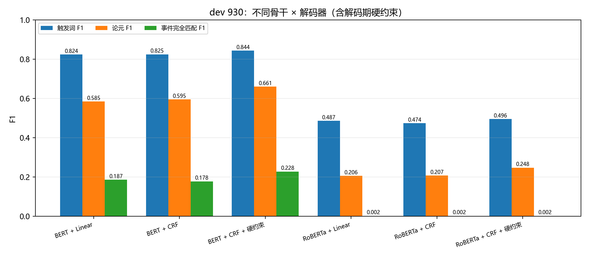
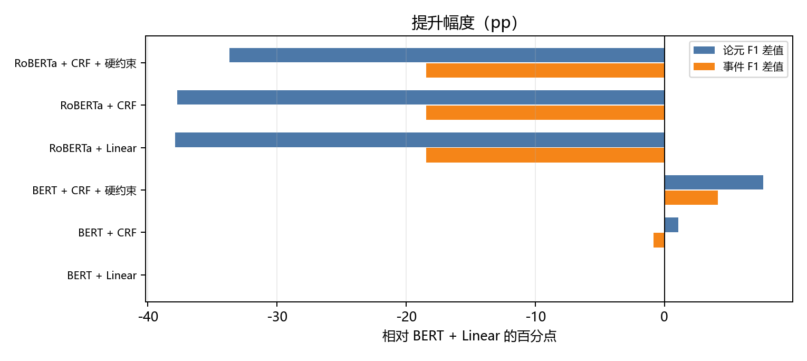
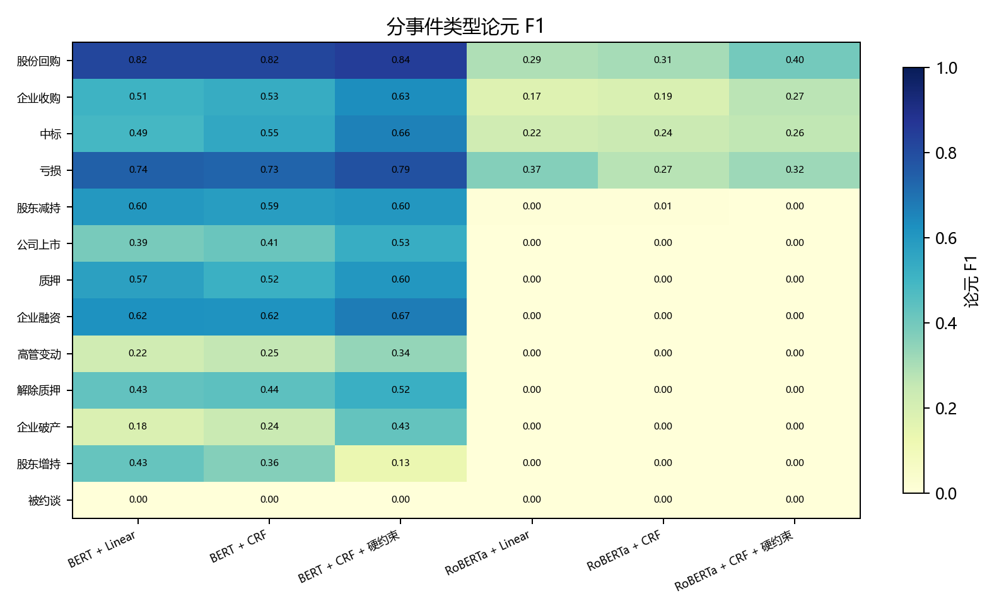
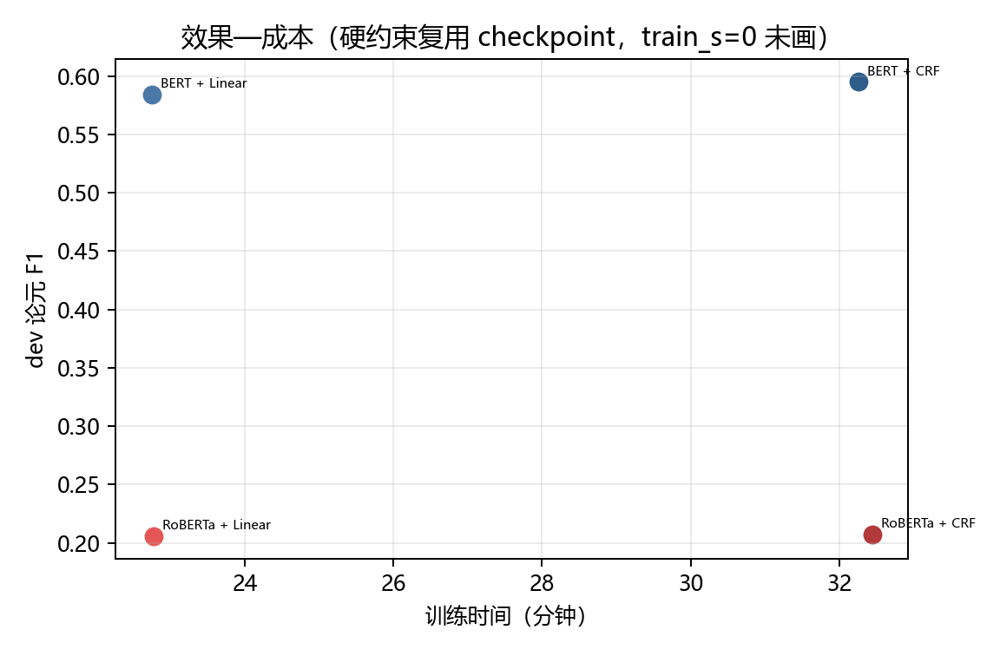
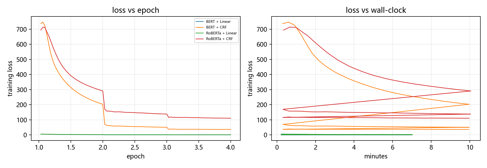

# 实验结果：BERT vs RoBERTa、Linear vs CRF vs 硬约束

数据：DuEE-Fin 派生（13 事件类型 / 92 槽位 / 61 角色），train 5,747 句，dev 930 句；joint 149 标签 BIO；评测口径与课程基线完全一致（`src/evaluate_events.py`，trigger 文本完全匹配、论元按 (role,text) Counter）。

> 本文件由 `experiments/summarize.py` 自动生成，数字来自 `outputs/metrics/disc/*.json`；叙述性结论见根目录 `README.md`。

## 1. 主表（dev 930）

| 方法 | 触发词 F1 | 论元 F1 | 事件 F1 | Δ论元 vs BERT+Linear | Δ事件 | n200 论元 F1 | 训练(s) | 推理(ms/句) | 非法率 | 参数量 |
|---|---:|---:|---:|---:|---:|---:|---:|---:|---:|---:|
| BERT + Linear | 0.8242 | 0.5845 | 0.1868 | +0.00pp | +0.00pp | 0.5917 | 1365 | 61.12 | 64.8% | 102.4M |
| BERT + CRF | 0.8251 | 0.5952 | 0.1782 | +1.07pp | -0.86pp | 0.5958 | 1936 | 81.92 | 64.6% | 102.4M |
| BERT + CRF + 硬约束 | 0.8441 | 0.6611 | 0.2281 | +7.66pp | +4.13pp | 0.6692 | 0 | 81.56 | 7.7% | 102.4M |
| RoBERTa + Linear | 0.4866 | 0.2058 | 0.0024 | -37.87pp | -18.44pp | 0.1901 | 1366 | 61.95 | 95.0% | 102.4M |
| RoBERTa + CRF | 0.4743 | 0.2074 | 0.0024 | -37.71pp | -18.44pp | 0.1939 | 1946 | 81.79 | 95.3% | 102.4M |
| RoBERTa + CRF + 硬约束 | 0.4958 | 0.2479 | 0.0024 | -33.66pp | -18.44pp | 0.2307 | 0 | 78.88 | 5.9% | 102.4M |

### 1.1 与课程文件内 BERT 基线对照

课程基线来自 `baseline/`（原仓库 `outputs/metrics/disc/summary.md`），dev 930、评测脚本与本实验相同；差异主要来自本实验修正了 LayerNorm 的 `gamma/beta` 加载（见 README），以及 batch/seed 不同。

| 方法 | 指标 | 课程基线 | 本实验 | Δ(pp) |
|---|---|---:|---:|---:|
| BERT + Linear | 触发词 | 0.8293 | 0.8242 | -0.51 |
| BERT + Linear | 论元 | 0.5630 | 0.5845 | +2.15 |
| BERT + Linear | 事件 | 0.1564 | 0.1868 | +3.04 |
| BERT + CRF | 触发词 | 0.8320 | 0.8251 | -0.69 |
| BERT + CRF | 论元 | 0.5815 | 0.5952 | +1.37 |
| BERT + CRF | 事件 | 0.1697 | 0.1782 | +0.85 |
| BERT + CRF + 硬约束 | 触发词 | 0.8464 | 0.8441 | -0.23 |
| BERT + CRF + 硬约束 | 论元 | 0.6566 | 0.6611 | +0.45 |
| BERT + CRF + 硬约束 | 事件 | 0.2177 | 0.2281 | +1.04 |

## 2. 配对显著性检验

配对 bootstrap：同一批句子的重采样下标同时作用于两方法，5000 次，报告 F1 差值的 95% 区间与双侧 p；McNemar 用句子级「事件完全正确」做 2×2 精确检验。Δ = 后者 − 前者，正数表示后者更好。

| 对比 | 指标 | Δ(pp) | 95% CI | bootstrap p | McNemar p |
|---|---|---:|---|---:|---:|
| bert_linear_256 ↔ bert_crf_256 | trigger | +0.09 | [-0.99, +1.20] | 0.8548 | 0.2800 |
| bert_linear_256 ↔ bert_crf_256 | argument | +1.06 | [+0.17, +1.99] | 0.0192 | 0.2800 |
| bert_linear_256 ↔ bert_crf_256 | event | -0.86 | [-2.29, +0.55] | 0.2316 | 0.2800 |
| bert_crf_256 ↔ bert_crf_256_hard | trigger | +1.90 | [+1.08, +2.83] | 0.0002 | <0.0001 |
| bert_crf_256 ↔ bert_crf_256_hard | argument | +6.59 | [+5.52, +7.65] | 0.0002 | <0.0001 |
| bert_crf_256 ↔ bert_crf_256_hard | event | +4.99 | [+3.55, +6.48] | 0.0002 | <0.0001 |
| roberta_linear_256 ↔ roberta_crf_256 | trigger | -1.23 | [-2.11, -0.35] | 0.0056 | 1.0000 |
| roberta_linear_256 ↔ roberta_crf_256 | argument | +0.16 | [-0.52, +0.79] | 0.6476 | 1.0000 |
| roberta_linear_256 ↔ roberta_crf_256 | event | -0.01 | [-0.37, +0.35] | 0.7816 | 1.0000 |
| roberta_crf_256 ↔ roberta_crf_256_hard | trigger | +2.15 | [+0.65, +3.68] | 0.0068 | 1.0000 |
| roberta_crf_256 ↔ roberta_crf_256_hard | argument | +4.06 | [+3.41, +4.72] | 0.0002 | 1.0000 |
| roberta_crf_256 ↔ roberta_crf_256_hard | event | +0.00 | [+0.00, +0.01] | 0.2724 | 1.0000 |
| bert_crf_256 ↔ roberta_crf_256 | trigger | -35.08 | [-38.40, -31.75] | 0.0002 | <0.0001 |
| bert_crf_256 ↔ roberta_crf_256 | argument | -38.78 | [-40.83, -36.72] | 0.0002 | <0.0001 |
| bert_crf_256 ↔ roberta_crf_256 | event | -17.59 | [-20.09, -15.05] | 0.0002 | <0.0001 |
| bert_crf_256_hard ↔ roberta_crf_256_hard | trigger | -34.83 | [-38.15, -31.51] | 0.0002 | <0.0001 |
| bert_crf_256_hard ↔ roberta_crf_256_hard | argument | -41.31 | [-43.38, -39.17] | 0.0002 | <0.0001 |
| bert_crf_256_hard ↔ roberta_crf_256_hard | event | -22.57 | [-25.34, -19.89] | 0.0002 | <0.0001 |
| bert_linear_256 ↔ roberta_linear_256 | trigger | -33.76 | [-37.16, -30.34] | 0.0002 | <0.0001 |
| bert_linear_256 ↔ roberta_linear_256 | argument | -37.88 | [-39.97, -35.79] | 0.0002 | <0.0001 |
| bert_linear_256 ↔ roberta_linear_256 | event | -18.44 | [-21.03, -15.91] | 0.0002 | <0.0001 |

## 3. 分事件类型论元 F1

| 类型 | 支持数 | BERT + Linear | BERT + CRF | BERT + CRF + 硬约束 | RoBERTa + Linear | RoBERTa + CRF | RoBERTa + CRF + 硬约束 |
|---|---:|---:|---:|---:|---:|---:|---:|
| 股份回购 | 178 | 0.817 | 0.820 | 0.845 | 0.289 | 0.308 | 0.397 |
| 中标 | 116 | 0.491 | 0.550 | 0.661 | 0.221 | 0.237 | 0.261 |
| 企业收购 | 116 | 0.509 | 0.533 | 0.632 | 0.173 | 0.188 | 0.271 |
| 亏损 | 106 | 0.743 | 0.733 | 0.787 | 0.365 | 0.274 | 0.322 |
| 股东减持 | 83 | 0.598 | 0.586 | 0.602 | 0.005 | 0.005 | 0.000 |
| 公司上市 | 58 | 0.389 | 0.414 | 0.531 | 0.000 | 0.000 | 0.000 |
| 质押 | 57 | 0.572 | 0.518 | 0.604 | 0.000 | 0.000 | 0.000 |
| 企业融资 | 53 | 0.617 | 0.615 | 0.674 | 0.000 | 0.000 | 0.000 |
| 高管变动 | 48 | 0.220 | 0.255 | 0.340 | 0.000 | 0.000 | 0.000 |
| 解除质押 | 40 | 0.433 | 0.442 | 0.522 | 0.000 | 0.000 | 0.000 |
| 企业破产 | 33 | 0.185 | 0.239 | 0.426 | 0.000 | 0.000 | 0.000 |
| 股东增持 | 31 | 0.426 | 0.365 | 0.132 | 0.000 | 0.000 | 0.000 |
| 被约谈 | 11 | 0.000 | 0.000 | 0.000 | 0.000 | 0.000 | 0.000 |

## 4. 高频角色论元 F1（Top 20）

| 角色 | 支持数 | BERT + Linear | BERT + CRF | BERT + CRF + 硬约束 | RoBERTa + Linear | RoBERTa + CRF | RoBERTa + CRF + 硬约束 |
|---|---:|---:|---:|---:|---:|---:|---:|
| 披露时间 | 331 | 0.634 | 0.650 | 0.674 | 0.258 | 0.256 | 0.286 |
| 交易金额 | 225 | 0.724 | 0.756 | 0.787 | 0.076 | 0.081 | 0.186 |
| 每股交易价格 | 215 | 0.834 | 0.821 | 0.825 | 0.405 | 0.453 | 0.509 |
| 回购股份数量 | 158 | 0.829 | 0.839 | 0.861 | 0.000 | 0.000 | 0.013 |
| 回购方 | 152 | 0.896 | 0.885 | 0.907 | 0.599 | 0.493 | 0.535 |
| 中标公司 | 143 | 0.639 | 0.705 | 0.758 | 0.465 | 0.506 | 0.657 |
| 回购完成时间 | 137 | 0.788 | 0.782 | 0.817 | 0.640 | 0.650 | 0.736 |
| 事件时间 | 123 | 0.380 | 0.405 | 0.473 | 0.000 | 0.000 | 0.000 |
| 被收购方 | 123 | 0.490 | 0.528 | 0.573 | 0.152 | 0.206 | 0.291 |
| 公司名称 | 113 | 0.847 | 0.828 | 0.865 | 0.329 | 0.038 | 0.092 |
| 中标标的 | 110 | 0.252 | 0.304 | 0.395 | 0.167 | 0.216 | 0.234 |
| 收购方 | 108 | 0.531 | 0.560 | 0.600 | 0.013 | 0.000 | 0.051 |
| 股票简称 | 102 | 0.539 | 0.514 | 0.480 | 0.000 | 0.000 | 0.000 |
| 减持方 | 100 | 0.597 | 0.602 | 0.676 | 0.000 | 0.000 | 0.000 |
| 质押方 | 97 | 0.539 | 0.511 | 0.596 | 0.000 | 0.000 | 0.000 |
| 质押物 | 96 | 0.471 | 0.441 | 0.503 | 0.000 | 0.000 | 0.000 |
| 占公司总股本比例 | 86 | 0.802 | 0.806 | 0.842 | 0.000 | 0.000 | 0.000 |
| 财报周期 | 85 | 0.585 | 0.540 | 0.618 | 0.231 | 0.188 | 0.296 |
| 质押股票/股份数量 | 84 | 0.600 | 0.562 | 0.629 | 0.000 | 0.000 | 0.000 |
| 披露日期 | 79 | 0.605 | 0.642 | 0.784 | 0.000 | 0.000 | 0.000 |

## 5. 图

